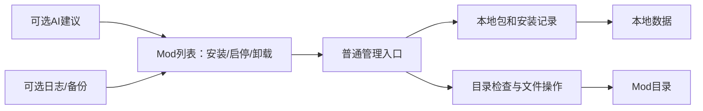

# 架构与现有模块复用

## 1. 最小结构

复用当前 Python 桌面宿主、Vue 工作台、本地包库和文件执行服务，完成普通 Mod 管理入口；不重写项目，也不为了简化文档先破坏现有接口。

普通 UI 动作是执行意图，AI 建议经用户选择后走同一入口。路径和 ZIP 检查放在后端；用户不需要理解 ActionPlan、Approval、journal 或 generation。

## 2. 当前代码与目标的区别

PS-03-07 的 `ModManager → mod.list/mod.action → ModService → planner/executor` 是默认入口，内部构造固定文件计划，不显示批准步骤。安装成员记录复用内部 Profile，与 executor 的文件提交一并发布；失败不会预先显示已安装。原 `plan.*`、history 和高级方案仍保持各自原接口，没有改变 schema 7。

不新增通用事务引擎、策略平台、审计服务、分阶段批准或更重的 AI Agent 框架。日志、配置编辑、启动、历史和 AI 可独立使用，不互相绑成安装前置。

## 3. 复用位置

| 位置 | 当前用途与后续取舍 |
|---|---|
| `main.py`、`backend/app/` | 已有独立桌面入口和 API 接线 |
| `backend/catalog/`、`backend/profiles/` | 复用导入、包信息；Profile 保留为可选组合功能 |
| `backend/deployments/` | 复用文件操作；旧审批/恢复实现不再作为用户流程要求 |
| `backend/games/probably_stolen/` | 复用安装选择；启动按钮按需实现 |
| `backend/scanning/`、`tools/PSModManager.Metadata/` | 元数据读取，保持不执行 DLL 和基本大小/耗时限制 |
| `backend/storage/`、`backend/contracts/` | 现有存储和 DTO 保持兼容，避免为本次目标调整强行迁移 |
| `backend/diagnostics/`、`backend/ai/` | 可选日志与 AI，不阻塞普通文件管理 |
| `frontend/src/app/`、`frontend/src/features/` | 沿用列表/详情/导入 UI，简化日常动作入口 |
| `tests/`、`scripts/` | 按受影响行为选择检查，不扩大为全任务统一审批 |

具体当前实现以源码为准；旧数据/API 详细原文见 Git 基线中的[契约备份](https://github.com/1299489456/PSModManager/blob/c4ee861fd5c999966aba367a2a51c9bc74b4ff73/docs/development/changes/20261012-scope-simplification/before/03-data-contracts.md)。

## 4. 基本边界

管理器数据与游戏目录分离。后端从已选择安装和包记录计算目标，不开放任意 shell、任意删除路径或第三方网页业务调用。

导入不执行 DLL/安装脚本；ZIP 不越出目标，坏输入有错误提示。普通复制或删除失败不先宣称成功；只提示必要的占用/权限/空间问题。旧 helper 的额外隔离实现可以继续复用，但不把系统级沙箱证明作为每张功能卡的前置。

原 RimCrow 源目录只读，不导入其真实数据库或启动有副作用的旧入口。沿用已经可用的依赖，不因文档简化自动安装或换技术栈。
