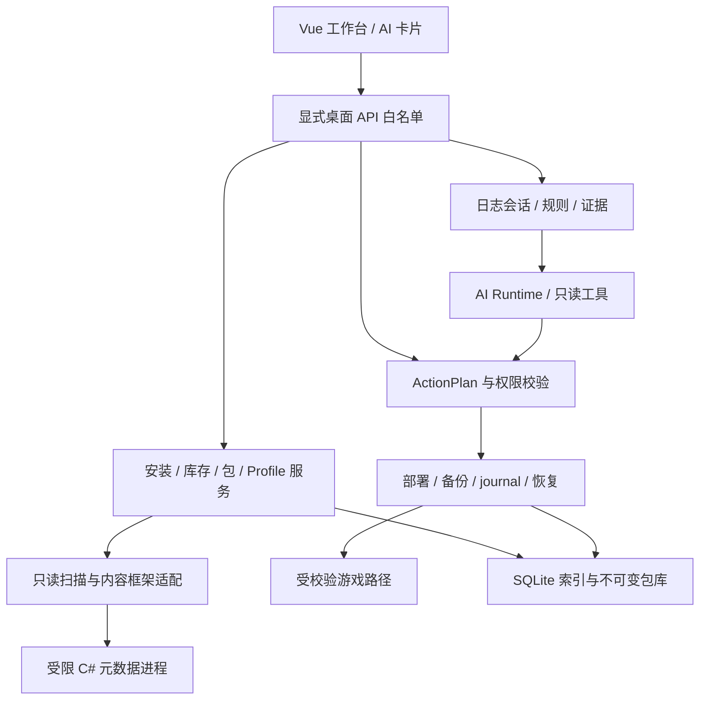

# 架构与 RimCrow 迁移边界

## 1. 技术决策

沿用 Python 3.11 基线、pywebview/WebView2、Vue 3/JavaScript、Pinia、Vite、Peewee/SQLite、Pydantic。首轮基于固定 RimCrow 提交裁剪；不把整份 9004 行 API 搬成新业务入口。保留原锁文件用于基线复现，裁剪依赖必须产生清单、锁文件差异和对应验证。

元数据工具选独立 C# `net10.0` 控制台辅助程序，使用标准 `System.Reflection.Metadata`，通过 JSON stdin/stdout 协议连接 Python；不在管理器中 Assembly.Load。游戏端 net6 不因此改变。net10 是规划选择，SDK 是否安装尚未验证；新增安装/依赖仍按执行授权处理。

2026-09-28 核对 [.NET 官方支持策略](https://dotnet.microsoft.com/en-us/platform/support/policy/dotnet-core)：.NET 10 为受支持 LTS。.NET 独立辅助进程不等于沙箱；[PEReader 官方注意事项](https://learn.microsoft.com/en-us/dotnet/api/system.reflection.portableexecutable.pereader?view=net-10.0) 要求认真处理不可信输入风险。

## 2. 模块关系



仅保留 `ProbablyStolenAdapter`（安装/启动/日志）、`MelonLoaderAdapter`（版本/发现规则）、内容框架识别器三个小边界。不要建泛化插件市场或同时支持多个桌面宿主。

## 3. 目标目录（尚待任务创建）

```text
main.py                         # 产品入口，导入本身不访问游戏
backend/app/                    # composition.py, identity.py, paths.py, api.py
backend/contracts/              # 安装、包、Profile、计划、事件 DTO
backend/storage/                # db.py, models.py, migrations/, repositories.py
backend/games/probably_stolen/   # discovery.py, layout.py, fingerprint.py, launch.py
backend/loaders/melonloader/    # v073.py，未知版本只读降级
backend/scanning/               # inventory.py, worker_client.py, content_manifests.py
backend/catalog/                # packages.py, ownership.py, imports.py
backend/profiles/               # service.py, compatibility.py
backend/deployments/            # paths.py, lease.py, planner.py, executor.py,
                                # journal.py, recovery.py, rollback.py, config.py
backend/diagnostics/            # tailer.py, sessions.py, evidence.py, rules.py
backend/ai/                     # 选择性迁移 runtime/gateway/trace，新增 policy/tools
backend/runtime/                # jobs.py, events.py, verification.py
frontend/src/app/               # 独立启动、bridge、路由、布局
frontend/src/features/          # installations, catalog, profiles, deployments,
                                # diagnostics, ai, history, settings
frontend/src/shared/            # 复用 UI / i18n / 日志格式
tools/PSModManager.Metadata/    # .csproj 与纯元数据读取器
tests/unit/, integration/, desktop/, acceptance/, fixtures/
tests/metadata/                 # 自制 C# fixture 源码与解析器测试
scripts/                       # verify.ps1、fixture 构建、打包
```

目标目录允许在负责任务内做必要细化；跨模块公开契约变化需同步 03/04 和消费者测试。新 Python 模块不通过 import 初始化 settings 单例、扫描线程或网络下载。

## 4. 迁移清单

| RimCrow 来源 | 新项目策略 | 负责任务 |
|---|---|---|
| `main.py`、前端 app/shared | 保留受控桌面入口与视觉基础，关闭 browser RPC | PS-00-02、PS-00-04 |
| `backend/settings.py` | 只借配置机制；重做 data root、迁移与凭据命名空间 | PS-00-02、PS-04-01 |
| `backend/api.py` | 不整体继承；公开窄 facade，按领域注入 | PS-00-04 |
| `backend/database/` | 参考连接/迁移方式，创建全新 schema，不导入 RimCrow DB | PS-00-03 |
| `backend/scanner/` | 不调用旧扫描流程；About.xml/自动清理/ACF 修正均排除 | PS-01-02、PS-01-03 |
| `mgr_load_order.py`、`mgr_sorter.py` | 只参考差异/版本 token/关系解释；重写部署和兼容语义 | PS-02-04、PS-03-02 |
| `utils/event_bus.py` | 借事件/进度机制，增加 task_id/sequence/terminal 契约 | PS-00-04 |
| `utils/tools.py`、包安装暂存 | 借原子写的局部实现，不直接暴露 delete_fs_path | PS-03-01、PS-03-03 |
| `mgr_game_logs.py` | 复用查看 UI；文本 tail 与会话解析重写 | PS-01-05 |
| `assistant_runtime.py`、gateway、trace | 保留流式/轨迹理念，执行时重新校验允许工具 | PS-04-01、PS-04-02 |
| `def_entries.py`、`def_actions.py`、`aiActionRuntime.js` | 全部替换 RimWorld 提示/动作，接 ActionPlan | PS-04-03 |
| 打包脚本 | 选择 PyInstaller 一个首版路径，包含独立 helper | PS-05-02 |
| Steamworks、SteamCMD、贴图、多人、社区规则和更新器 | 从启动依赖中移除；隐藏按钮不足以隔离 | PS-00-01、PS-00-02 |

当前参考代码的重要限制：扫描会写入；保存允许自动备份失败后继续；删除先更新 DB、磁盘失败不回滚。新项目不得继承这些行为作为安全保证。

## 5. 进程与数据路径

默认数据根 `%LOCALAPPDATA%/PSModManager/`；开发/测试可用 `--psmm-data-root <absolute>` 显式覆盖。启动前拒绝与 RimCrow、游戏根、包来源目录重叠的数据根。数据库和包库都在该根下；事务同卷 staging 由部署服务管理，不允许任意前端传路径。

只读扫描：父进程校验文件身份与范围，提供最小读取能力；worker 使用受限 token/ACL、禁网边界、Job Object 和有界 IO，超时终止整个子进程树。普通子进程隔离只证明抗崩溃，不能冒称抵御恶意文件；安全隔离无法证明时，不开放未知来源深度解析，仍允许哈希登记。

桌面桥接只接受 schema 化业务命令，外链用系统浏览器打开；不为第三方页面注入 js_api。首版不提供监听 localhost 的业务 RPC 服务。

## 6. 构建与测试依赖

PS-00-01 盘点现有 Python/Node/uv/.NET/WebView2 与锁文件，不自动安装。Vite 7 的实际 Node 要求按锁定版本官方资料在开发基线任务中记录，不能沿用 README 中宽泛的 Node 18+。

现有 `npm run build` 有 prebuild，间接触发 `uv run`，可能自动恢复依赖；PS-00-02 要改成明确环境检查与 `uv run --no-sync`，验证命令本身不联网安装。前端首轮使用 Node 内置断言/测试运行器测纯状态；新增组件/E2E 框架须另作依赖决策。真实 WebView bridge harness 由 PS-00-04 建立，不能用浏览器 mock 替代。
